# Storyboard

Un fotograma por plano, tomado hacia el 85 % de cada frase (versión vertical). Las imágenes están en `storyboard/`.

| Plano | Tiempo | Imagen | Narración | Fuente en pantalla |
|---|---|---|---|---|
| 01.01 · El gancho | 0:00 (10.4 s) | 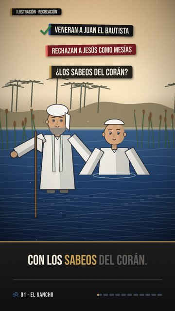 | Imagina una religión que venera a Juan el Bautista, pero rechaza a Jesucristo. Una religión que ya existía antes del islam, y que varios investigadores identifican con los sabeos del Corán. | — |
| 01.02 · El gancho | 0:10 (9.0 s) | 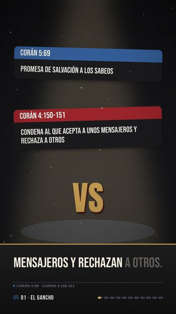 | Ahora viene el problema. El Corán promete salvación a los sabeos. Pero también condena a quienes aceptan a unos mensajeros y rechazan a otros. | CORÁN 5:69 · CORÁN 4:150-151 |
| 01.03 · El gancho | 0:20 (8.5 s) | 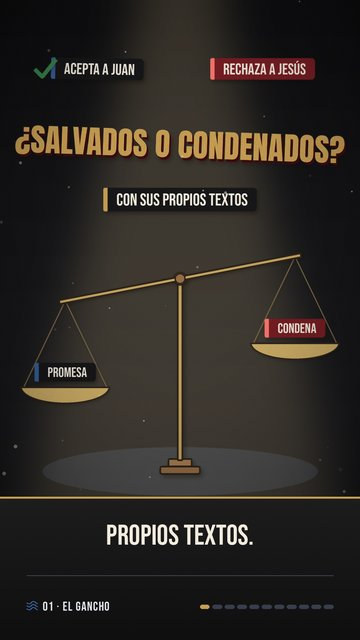 | ¿Qué pasa con una religión que acepta a Juan y rechaza a Jesús? ¿Se salva, o se condena? Vamos a verlo con sus propios textos. | — |
| 02.01 · Quiénes son los mandeos | 0:29 (9.2 s) | 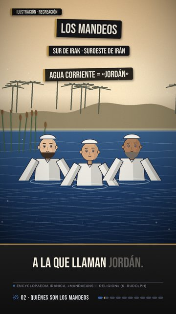 | Los mandeos. Una pequeña comunidad del sur de Irak y del suroeste de Irán. Se bautizan una y otra vez en agua corriente, a la que llaman Jordán. | ENCYCLOPAEDIA IRANICA, «MANDAEANS ii. RELIGION» (K. RUDOLPH) |
| 02.02 · Quiénes son los mandeos | 0:38 (9.1 s) |  | Su lengua sagrada es el mandeo, un arameo oriental. Su dios supremo, la Gran Vida. Sus libros: la Ginza y el Libro de Juan. | ENCYCLOPAEDIA IRANICA, «MANDAEANS ii. RELIGION» (K. RUDOLPH) |
| 02.03 · Quiénes son los mandeos | 0:48 (13.4 s) | 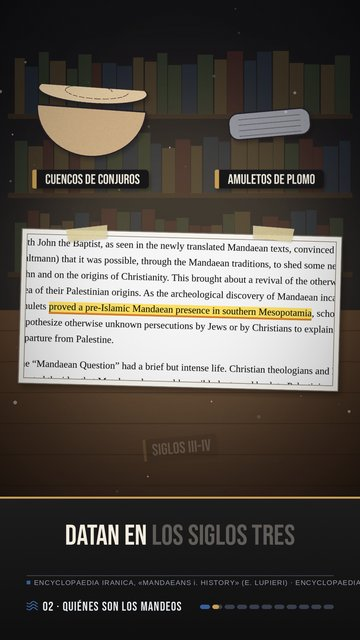 | ¿Son anteriores al islam? Sí. Los arqueólogos han hallado cuencos de conjuros y amuletos de plomo mandeos, que prueban su presencia en Mesopotamia antes del islam. Los más antiguos se datan en los siglos tres o cuatro. | ENCYCLOPAEDIA IRANICA, «MANDAEANS i. HISTORY» (E. LUPIERI) · ENCYCLOPAEDIA IRANICA, «MANDAEANS ii. RELIGION» (K. RUDOLPH) |
| 02.04 · Quiénes son los mandeos | 1:01 (13.0 s) | 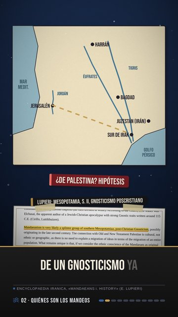 | ¿Vienen de los discípulos de Juan en Palestina? Eso es solo una hipótesis. Edmondo Lupieri, por ejemplo, cree más probable que surgieran en Mesopotamia, hacia el siglo dos, de un gnosticismo ya posterior a Cristo. | ENCYCLOPAEDIA IRANICA, «MANDAEANS i. HISTORY» (E. LUPIERI) |
| 03.01 · La promesa | 1:15 (8.5 s) | 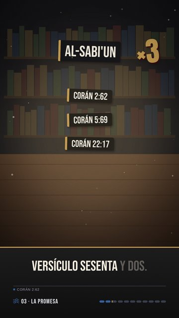 | Ahora, el Corán. La palabra sabeos aparece tres veces. La primera, en la sura dos, versículo sesenta y dos. | CORÁN 2:62 |
| 03.02 · La promesa | 1:24 (11.1 s) | 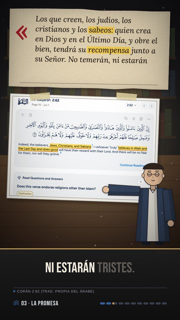 | CITA: Los que creen, los judíos, los cristianos y los sabeos: quien crea en Dios y en el Último Día, y obre el bien, tendrá su recompensa junto a su Señor. No temerán, ni estarán tristes. | CORÁN 2:62 (TRAD. PROPIA DEL ÁRABE) |
| 03.03 · La promesa | 1:35 (13.1 s) | 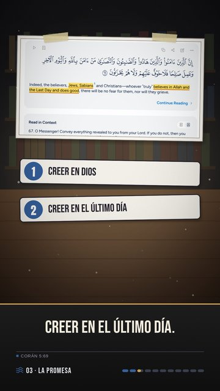 | La sura cinco, versículo sesenta y nueve, lo repite casi igual. Y fíjate en las condiciones expresas: son tres. Creer en Dios. Creer en el Último Día. Y obrar el bien. | CORÁN 5:69 |
| 03.04 · La promesa | 1:48 (9.7 s) | 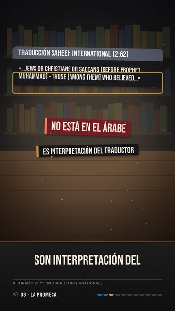 | Ojo: algunas traducciones añaden entre corchetes «antes del profeta Mahoma». Esas palabras no están en el árabe. Son interpretación del traductor. | CORÁN 2:62 Y 5:69 (SAHEEH INTERNATIONAL) |
| 03.05 · La promesa | 1:58 (9.4 s) | 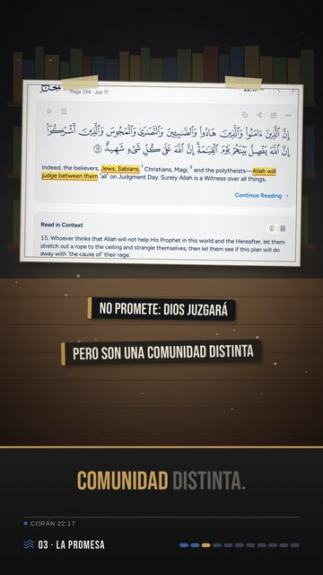 | Veintidós, diecisiete, no promete nada: solo dice que Dios juzgará entre todas esas comunidades. Pero confirma que los sabeos son una comunidad distinta. | CORÁN 22:17 |
| 04.01 · ¿sabeos = mandeos? | 2:08 (9.0 s) | 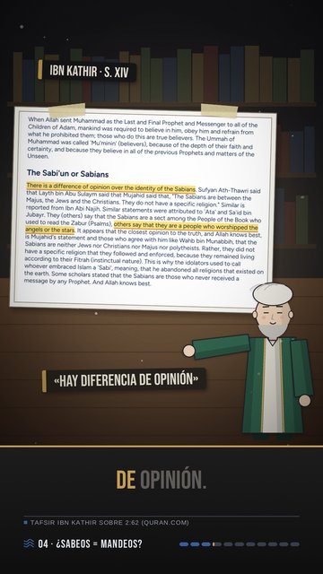 | ¿Quiénes eran esos sabeos? Los primeros comentaristas musulmanes no se ponían de acuerdo. Ibn Kathir lo reconoce: hay diferencia de opinión. | TAFSIR IBN KATHIR SOBRE 2:62 (QURAN.COM) |
| 04.02 · ¿sabeos = mandeos? | 2:18 (6.2 s) | 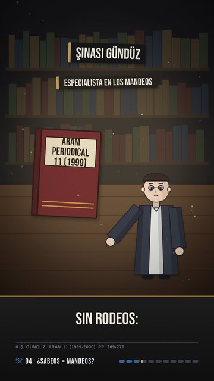 | Hoy, varios especialistas apuntan a los mandeos. Sinasi Gündüz lo escribe sin rodeos: | Ş. GÜNDÜZ, ARAM 11 (1999-2000), PP. 269-279 |
| 04.03 · ¿sabeos = mandeos? | 2:24 (5.7 s) | 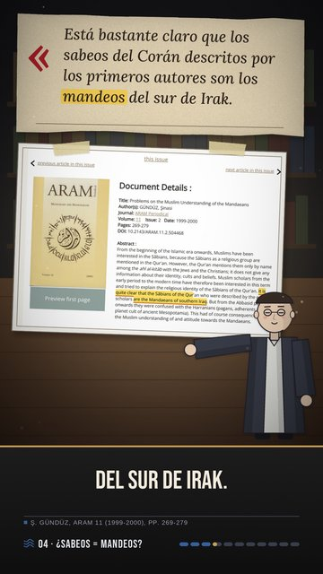 | CITA: Está bastante claro que los sabeos del Corán descritos por los primeros autores son los mandeos del sur de Irak. | Ş. GÜNDÜZ, ARAM 11 (1999-2000), PP. 269-279 |
| 04.04 · ¿sabeos = mandeos? | 2:30 (12.4 s) | 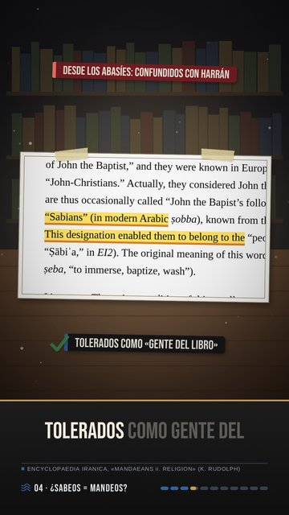 | Y añade que, desde los abasíes, se los confundió con los paganos de Harrán. La enciclopedia Iranica confirma la otra mitad: los musulmanes llamaron sabeos a los mandeos, y eso les permitió ser tolerados como gente del Libro. | ENCYCLOPAEDIA IRANICA, «MANDAEANS ii. RELIGION» (K. RUDOLPH) |
| 04.05 · ¿sabeos = mandeos? | 2:43 (9.9 s) | 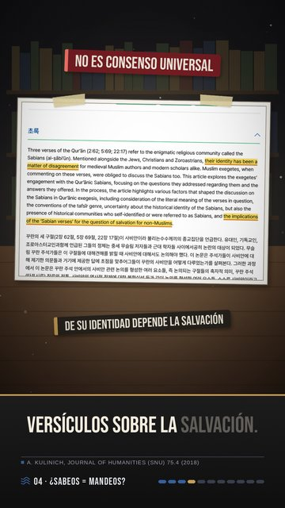 | Pero cuidado: no es un consenso universal. Alena Kulinich muestra que su identidad sigue discutida, y que de ella depende cómo se leen estos versículos sobre la salvación. | A. KULINICH, JOURNAL OF HUMANITIES (SNU) 75.4 (2018) |
| 05.01 · Los comentaristas | 2:53 (12.1 s) |  | Y la incertidumbre de los primeros comentaristas es muy significativa. El Corán menciona a los sabeos tres veces, pero no explica quiénes son. Y las generaciones posteriores dieron descripciones muy distintas. | AL-TABARI, TAFSIR SOBRE 2:62 |
| 05.02 · Los comentaristas | 3:06 (8.7 s) | 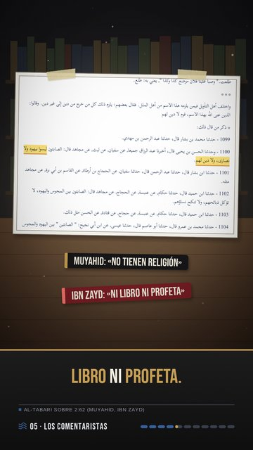 | Para Muyahid, no eran judíos ni cristianos, y no tenían religión. Para Ibn Zayd, vivían en la región de Mosul, y no tenían ni libro ni profeta. | AL-TABARI SOBRE 2:62 (MUYAHID, IBN ZAYD) |
| 05.03 · Los comentaristas | 3:15 (10.5 s) | 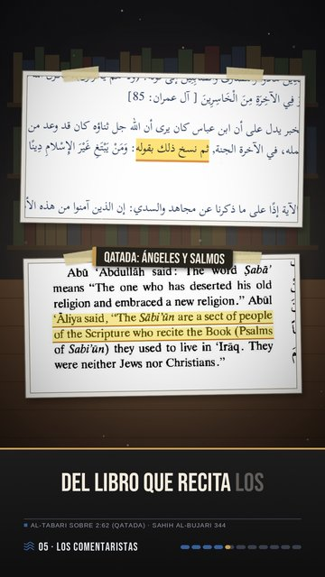 | Para Qatada, adoraban a los ángeles y leían los Salmos. Y en Bujari aparece una idea parecida, atribuida a Abu al-Aliya: una secta de la gente del Libro que recita los Salmos. | AL-TABARI SOBRE 2:62 (QATADA) · SAHIH AL-BUJARI 344 |
| 05.04 · Los comentaristas | 3:25 (8.1 s) | 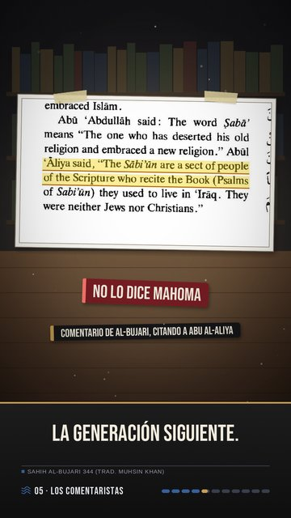 | Ojo: eso no lo dice Mahoma. Es un comentario que al-Bujari añade al final de un hadiz, citando a un sabio de la generación siguiente. | SAHIH AL-BUJARI 344 (TRAD. MUHSIN KHAN) |
| 05.05 · Los comentaristas | 3:34 (12.7 s) | 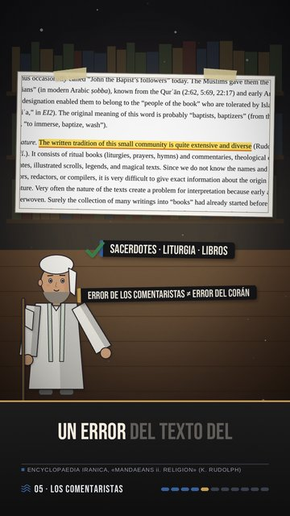 | Y los mandeos reales tienen sacerdotes, liturgia, y una literatura sagrada extensa. Esto muestra que los comentaristas no sabían bien de quién hablaban. No demuestra, por sí solo, un error del texto del Corán. | ENCYCLOPAEDIA IRANICA, «MANDAEANS ii. RELIGION» (K. RUDOLPH) |
| 06.01 · Juan sí, jesús no | 3:47 (8.4 s) | 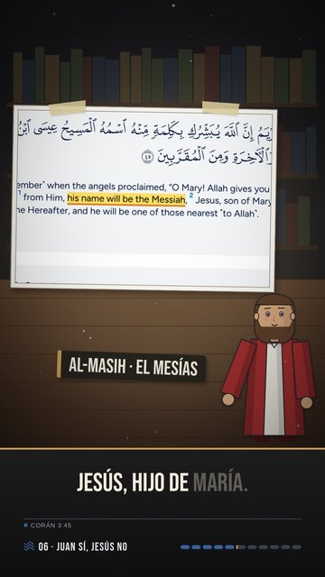 | Ahora mira qué dice el Corán de Juan y de Jesús. Tres, cuarenta y cinco: su nombre será el Mesías, Jesús, hijo de María. | CORÁN 3:45 |
| 06.02 · Juan sí, jesús no | 3:56 (10.0 s) | 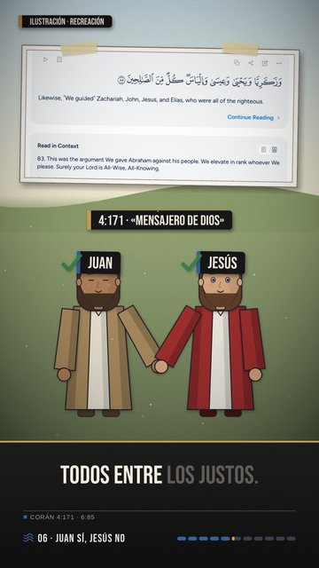 | Cuatro, ciento setenta y uno: el Mesías es mensajero de Dios. Y seis, ochenta y cinco, pone juntos a Zacarías, Juan y Jesús: todos entre los justos. | CORÁN 4:171 · 6:85 |
| 06.03 · Juan sí, jesús no | 4:06 (7.9 s) | 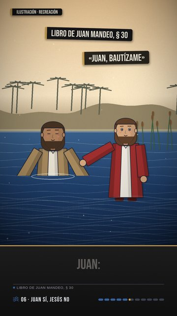 | Y ahora, el Libro de Juan mandeo. Jesús va al Jordán y le pide a Juan que lo bautice. Esta es la respuesta de Juan: | LIBRO DE JUAN MANDEO, § 30 |
| 06.04 · Juan sí, jesús no | 4:14 (3.7 s) | 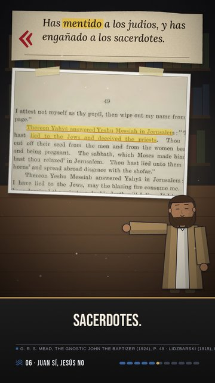 | CITA: Has mentido a los judíos, y has engañado a los sacerdotes. | G. R. S. MEAD, THE GNOSTIC JOHN THE BAPTIZER (1924), P. 49 · LIDZBARSKI (1915), P. 104 |
| 06.05 · Juan sí, jesús no | 4:18 (5.0 s) | 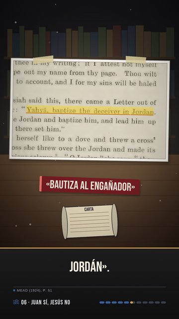 | Y al final llega una carta del mundo de la luz: «Juan, bautiza al engañador en el Jordán». | MEAD (1924), P. 51 |
| 06.06 · Juan sí, jesús no | 4:23 (6.6 s) | 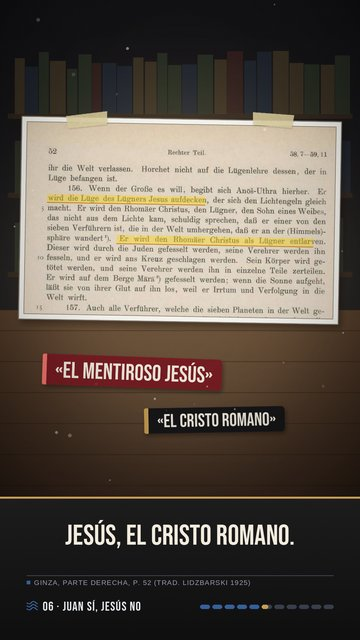 | La Ginza es aún más dura: el enviado de la luz desenmascarará la mentira del mentiroso Jesús, el Cristo romano. | GINZA, PARTE DERECHA, P. 52 (TRAD. LIDZBARSKI 1925) |
| 06.07 · Juan sí, jesús no | 4:30 (12.1 s) | 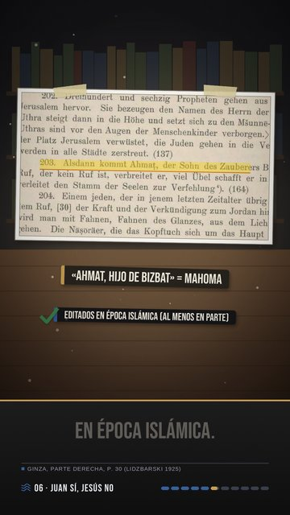 | Pero seamos rigurosos. Esa parte de la Ginza menciona a «Ahmat, hijo de Bizbat»: según Lidzbarski, Mahoma. Así que estos textos se editaron, al menos en parte, en época islámica. | GINZA, PARTE DERECHA, P. 30 (LIDZBARSKI 1925) |
| 06.08 · Juan sí, jesús no | 4:42 (10.5 s) | 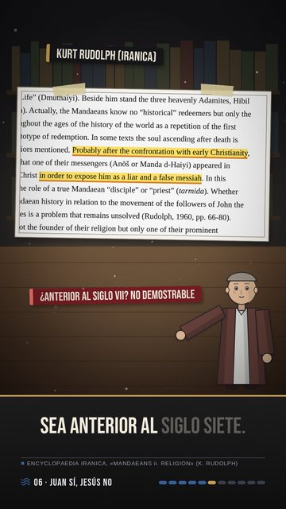 | Kurt Rudolph cree que esta polémica surgió tras el choque con el primer cristianismo. Pero los textos mezclan material antiguo y tardío: no se puede demostrar que sea anterior al siglo siete. | ENCYCLOPAEDIA IRANICA, «MANDAEANS ii. RELIGION» (K. RUDOLPH) |
| 07.01 · La condena | 4:54 (6.9 s) | 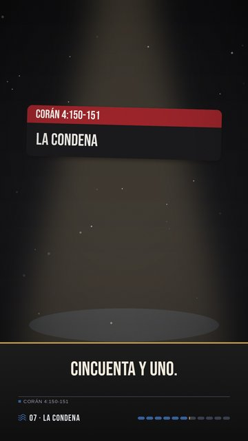 | Y ahora, el segundo texto del Corán. Sura cuatro, versículos ciento cincuenta y ciento cincuenta y uno. | CORÁN 4:150-151 |
| 07.02 · La condena | 5:01 (12.9 s) | 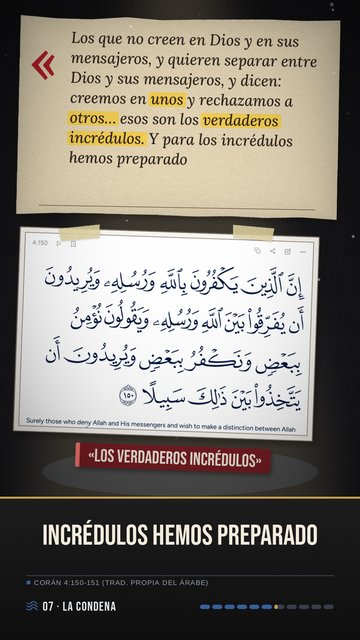 | CITA: Los que no creen en Dios y en sus mensajeros, y quieren separar entre Dios y sus mensajeros, y dicen: creemos en unos y rechazamos a otros… esos son los verdaderos incrédulos. Y para los incrédulos hemos preparado un castigo humillante. | CORÁN 4:150-151 (TRAD. PROPIA DEL ÁRABE) |
| 07.03 · La condena | 5:14 (12.4 s) | 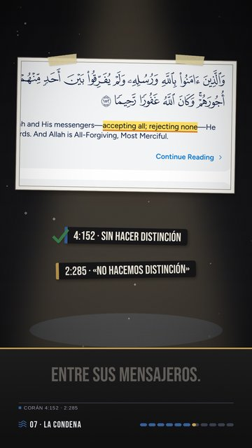 | El versículo siguiente lo remata: la recompensa es para quien cree en todos sus mensajeros, sin hacer distinción entre ninguno. Y dos, doscientos ochenta y cinco, repite: no hacemos distinción entre sus mensajeros. | CORÁN 4:152 · 2:285 |
| 07.04 · La condena | 5:26 (9.2 s) | 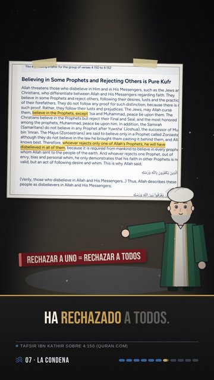 | Ibn Kathir lo aplica sin rodeos: los judíos creen en los profetas, excepto en Jesús y en Mahoma. Y quien rechaza a un solo profeta, ha rechazado a todos. | TAFSIR IBN KATHIR SOBRE 4:150 (QURAN.COM) |
| 07.05 · La condena | 5:36 (12.0 s) |  | Si los sabeos son los mandeos, encajan justo en esa descripción. Reconocen a Juan. Rechazan a Jesús como Mesías. Entonces, ¿por qué aparecen en la lista de los que se salvan? | — |
| 08.01 · El dilema | 5:48 (11.5 s) | 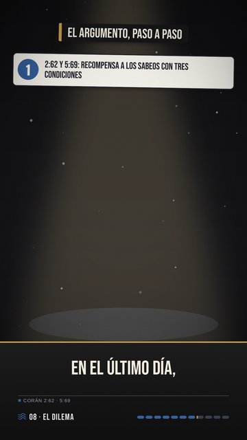 | Formulemos el argumento con cuidado. Uno: dos, sesenta y dos, y cinco, sesenta y nueve, prometen recompensa a los sabeos que crean en Dios, en el Último Día, y obren el bien. | CORÁN 2:62 · 5:69 |
| 08.02 · El dilema | 6:00 (12.2 s) | 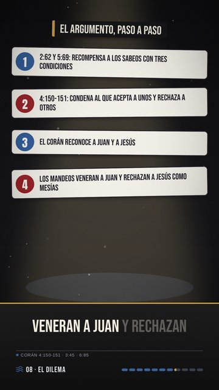 | Dos: cuatro, ciento cincuenta, condena a quien acepta a unos y rechaza a otros. Tres: el Corán reconoce a Juan y a Jesús. Cuatro: los mandeos veneran a Juan y rechazan a Jesús. | CORÁN 4:150-151 · 3:45 · 6:85 |
| 08.03 · El dilema | 6:13 (7.4 s) | 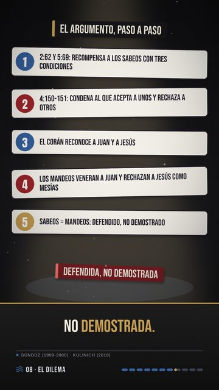 | Y cinco: la identificación entre sabeos y mandeos está defendida por especialistas. Defendida, no demostrada. | GÜNDÜZ (1999-2000) · KULINICH (2018) |
| 08.04 · El dilema | 6:20 (8.6 s) | 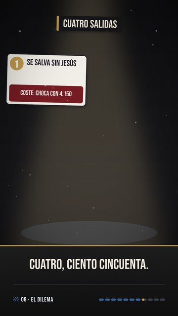 | Hay cuatro salidas. Primera: el sabeo se salva sin aceptar a Jesús. Pero entonces choca con cuatro, ciento cincuenta. | — |
| 08.05 · El dilema | 6:29 (7.8 s) | 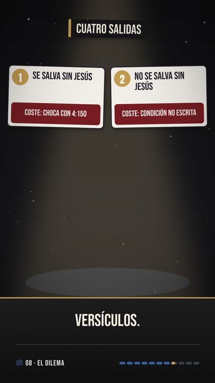 | Segunda: no se salva sin aceptar a Jesús. Pero entonces la promesa exige una condición que no está escrita en esos versículos. | — |
| 08.06 · El dilema | 6:37 (8.2 s) | 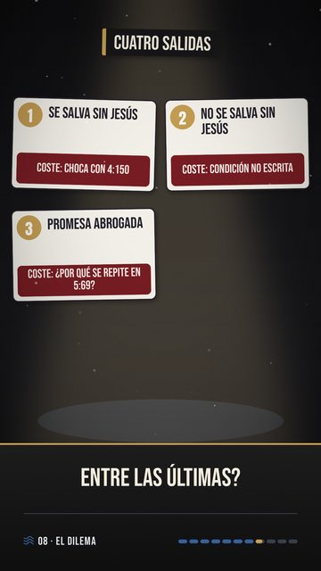 | Tercera: la promesa fue abrogada. Pero entonces, ¿por qué vuelve a aparecer en la sura cinco, que la tradición sitúa entre las últimas? | — |
| 08.07 · El dilema | 6:46 (14.6 s) | 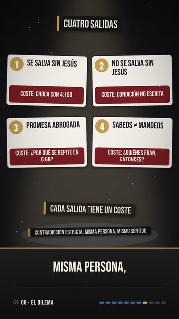 | Cuarta: los sabeos no eran los mandeos. Pero entonces hay que demostrar quiénes eran. Cada salida tiene un coste. Y para que haya contradicción en sentido estricto, ambas reglas tienen que aplicarse a la misma persona, en el mismo sentido. | — |
| 09.01 · Las respuestas | 7:01 (9.1 s) | 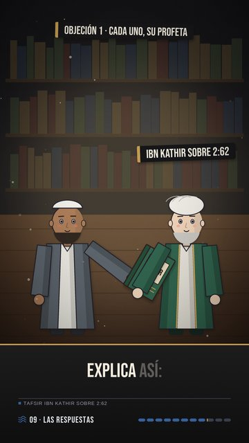 | Veamos las mejores respuestas musulmanas. La primera: cada pueblo se salvaba siguiendo al profeta de su época. Ibn Kathir lo explica así: | TAFSIR IBN KATHIR SOBRE 2:62 |
| 09.02 · Las respuestas | 7:10 (5.8 s) | 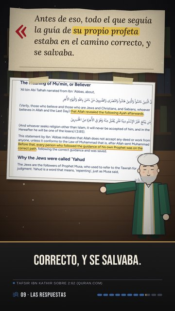 | CITA: Antes de eso, todo el que seguía la guía de su propio profeta estaba en el camino correcto, y se salvaba. | TAFSIR IBN KATHIR SOBRE 2:62 (QURAN.COM) |
| 09.03 · Las respuestas | 7:16 (8.2 s) |  | Es coherente. Pero lee las tres condiciones a la luz de otros versículos. ¿Y qué alcance tiene entonces nombrar a los sabeos? | — |
| 09.04 · Las respuestas | 7:25 (11.2 s) | 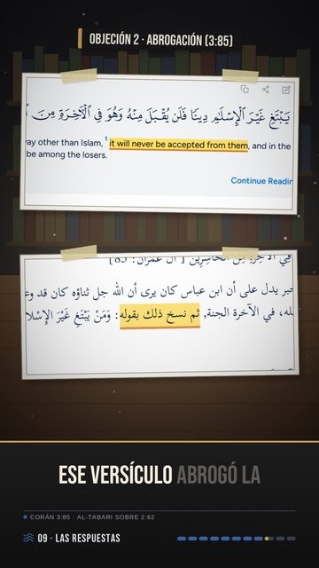 | La segunda: tres, ochenta y cinco. A quien busque una religión distinta del islam, no se le aceptará. Al-Tabari recoge que, según Ibn Abbas, ese versículo abrogó la promesa. | CORÁN 3:85 · AL-TABARI SOBRE 2:62 |
| 09.05 · Las respuestas | 7:36 (11.1 s) |  | Problema: cinco, sesenta y nueve, repite la promesa, y según Tirmidhi la sura cinco fue la última revelada. Muslim da otra sura, y la fecha de una sura no fija la de cada versículo. | TIRMIDHI 3063 · MUSLIM 1618 (AL-BARA) |
| 09.06 · Las respuestas | 7:47 (12.6 s) |  | La tercera respuesta: creer de verdad en Dios ya incluye aceptar a todos sus mensajeros. Es lógicamente coherente. Pero convierte una promesa que suena amplia en una promesa para quien acepta toda la revelación islámica. | — |
| 09.07 · Las respuestas | 8:00 (10.3 s) |  | La cuarta: quizá hubo unos sabeos originales fieles a un profeta propio, y el mandeísmo se corrompió después. Es posible en teoría. Pero, ¿qué fuente lo muestra? | CORÁN 16:36 · 35:24 |
| 09.08 · Las respuestas | 8:11 (11.3 s) |  | Y la quinta: Dios no castiga a quien no recibió bien el mensaje. Es justo reconocerlo. Pero la objeción apunta al que rechaza a Jesús a sabiendas, y cumple las otras tres condiciones. | CORÁN 17:15 · 4:165 |
| 10.01 · La investigación | 8:23 (7.9 s) | 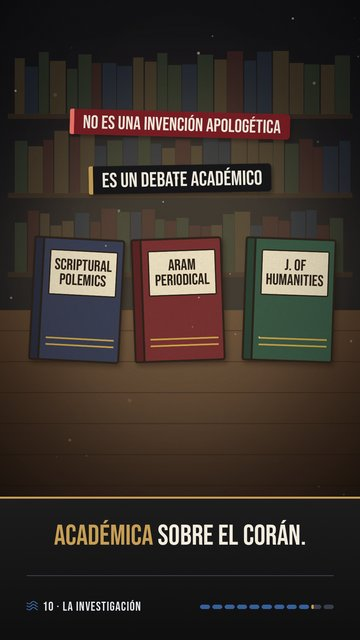 | Esta dificultad no es una invención de los apologetas cristianos. Es un problema estudiado dentro de la investigación académica sobre el Corán. | — |
| 10.02 · La investigación | 8:31 (12.6 s) | 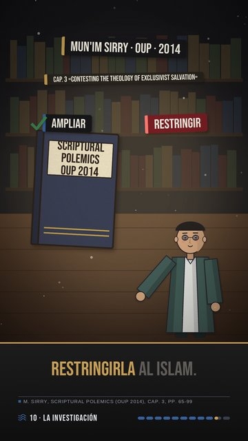 | Mun'im Sirry, en Scriptural Polemics, Oxford University Press, dos mil catorce, dedica un capítulo al debate sobre la salvación exclusivista: los versículos que parecen ampliar la salvación, frente a los que parecen restringirla al islam. | M. SIRRY, SCRIPTURAL POLEMICS (OUP 2014), CAP. 3, PP. 65-99 |
| 10.03 · La investigación | 8:44 (8.1 s) | 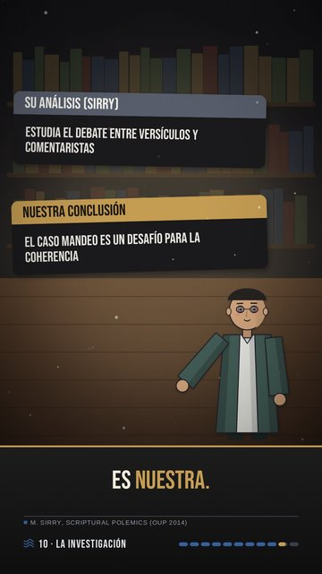 | Sirry no dice haber demostrado una contradicción insalvable. Analiza un debate. La conclusión apologética es nuestra. | M. SIRRY, SCRIPTURAL POLEMICS (OUP 2014) |
| 10.04 · La investigación | 8:52 (5.5 s) | 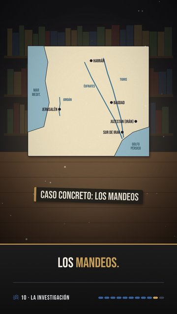 | Lo que hacemos en este vídeo es aplicar esa dificultad general a una comunidad concreta: los mandeos. | — |
| 11.01 · El veredicto | 8:58 (8.7 s) | 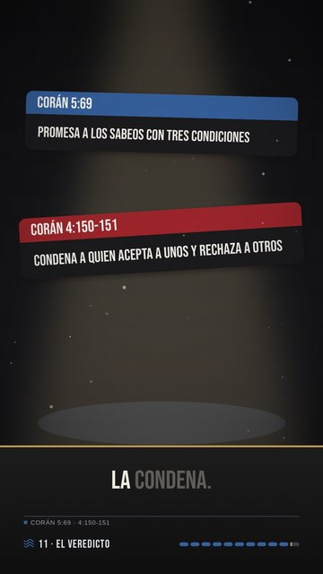 | Volvamos a los dos versículos. Cinco, sesenta y nueve: la promesa. Cuatro, ciento cincuenta: la condena. | CORÁN 5:69 · 4:150-151 |
| 11.02 · El veredicto | 9:07 (4.9 s) |  | El dilema de los mandeos revela una dificultad de fondo en la doctrina coránica de la salvación. | — |
| 11.03 · El veredicto | 9:12 (12.3 s) | 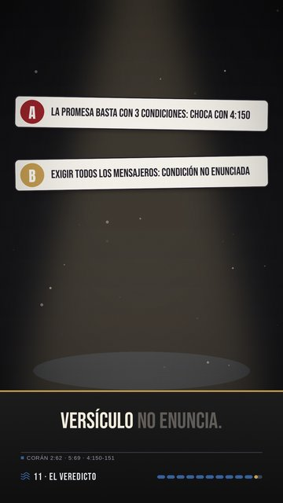 | Si la promesa basta con sus tres condiciones expresas, choca con la condena de quien rechaza a los profetas. Si además exigimos aceptar a todos los mensajeros, la promesa se lee con una condición que el versículo no enuncia. | CORÁN 2:62 · 5:69 · 4:150-151 |
| 11.04 · El veredicto | 9:25 (10.4 s) | 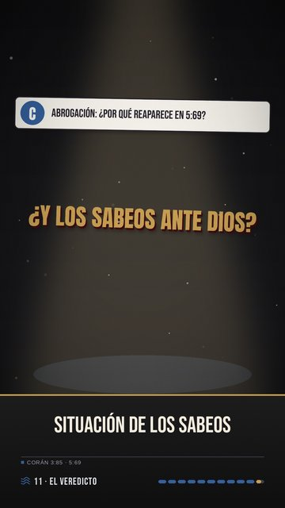 | Y si recurrimos a la abrogación, aún hay que explicar por qué la promesa reaparece en una de las últimas suras. La pregunta sigue en pie: ¿cuál era exactamente la situación de los sabeos ante Dios? | CORÁN 3:85 · 5:69 |
| 11.05 · El veredicto | 9:36 (9.0 s) | 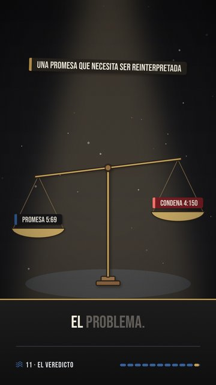 | El Corán ofrece una promesa que, para ser coherente con otros pasajes, necesita ser reinterpretada. El caso de los mandeos hace visible el problema. | — |
| 11.06 · El veredicto | 9:45 (10.8 s) |  | Esto no va contra los musulmanes, a quienes respetamos. ¿Salvados o condenados? Comenta tu respuesta. Y si quieres las fuentes, pídelas en comentarios. | — |
